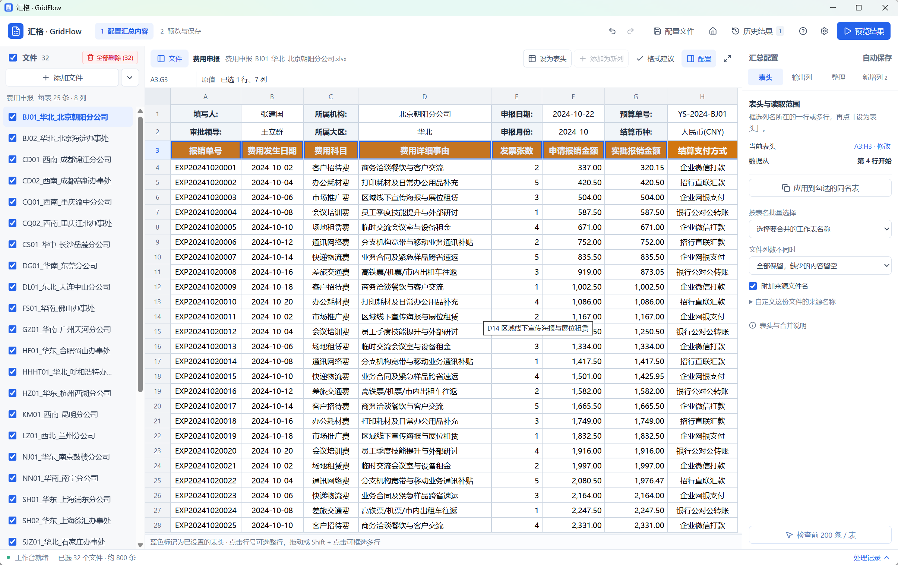

# 汇格 · GridFlow

> **汇格（GridFlow）** 是一款面向 Windows 桌面端的专业本地表格合并与分析工具：专为日常办公中繁重复杂的多表汇总需求设计，无需编写脚本或复杂公式，通过可视化直观操作，将分散、异构的多份 Excel / CSV 快速合并为规范母表，并直接在本地完成数据清洗、多维汇总统计与图表分析。全部计算与存储均在本机离线完成，商业数据零泄露。

[](https://github.com/d8349565/GridFlow/releases)
[](https://github.com/d8349565/GridFlow/releases)
[](#下载与使用-installation)
[](#数据存储与安全-configuration--privacy)
[](LICENSE)

---

## 下载与使用 (Installation)

最新免安装便携版可直接从 GitHub Releases 获取：  
👉 **下载地址**：[https://github.com/d8349565/GridFlow/releases](https://github.com/d8349565/GridFlow/releases)

软件开箱即用，无需预装 Python、Node.js 或数据库服务：

1. 前往 [Releases 下载页](https://github.com/d8349565/GridFlow/releases) 下载最新发行包 `GridFlow-v2.0.0-win-x64.zip`；
2. 解压到本地任意目录（保持同级目录自带的 `duckdb.dll` 不被移动或删除）；
3. 双击 `GridFlow.exe` 即可直接运行。

> **系统要求**：支持 Windows 10 / 11 (x64) 系统。依赖 WebView2 运行时（Windows 11 系统已内置；未安装的环境可使用单独提供的微软官方离线安装包）。软件日常运行完全离线，不发网络请求、不回传数据。

---

## 3 步快速上手 (Quick Start)

从批量零散报表到整洁母表与统计图表，仅需三步：

1. **导入文件**：点击「添加文件/文件夹」或直接将 Excel（`.xlsx`、`.xls`）及各类编码的 CSV 文件拖拽至窗口，左侧自动列出文件，主视图高保真还原第一份原表外观。
2. **可视圈选表头与维度**：
   - 在原表区域鼠标划选表头行（支持单行、多行复合表头与合并单元格），点击「设为表头」；
   - 点选单据头部独立单元格（如“填报门店”、“所属月份”），点击「添加为新列」自动提取为整表维度。
3. **预览结果与导出**：
   - 点击顶部「预览结果」（或快捷键 `Ctrl + Enter`），引擎毫秒级合并所有文件；
   - 在结果页核对明细、按条件筛选过滤、分类汇总统计，一键导出为标准 XLSX、CSV 或统计图表图片。

**预期效果**：即时呈现清洗对齐后的单张大表，源文件分毫不变；十万行明细翻页延迟低于 30ms。





---

## 核心能力 (Features)

- **高保真原表还原** — 深度兼容 Excel 原生样式，保留字体、字号、颜色、对齐、边框、合并单元格及隐藏行列，保留视觉上下文，不修改用户原始文件。
- **复合表头与固定信息智能抽取** — 轻松处理多层合并表头，并能将孤立单元格（门店、日期、部门等）一键平铺为新增数据列。
- **十万级本地秒级运算引擎** — 采用 Rust 内核结合 DuckDB 列式引擎，10 万行报表合并不到 2 秒，筛选延迟低于 10ms，峰值工作集仅约 170MB，告别 Excel 卡顿假死。
- **智能格式清洗与异常容错** — 文本型数字前导零（如工号 `0089`）完整保留；混合日期与数值自适应识别；遇到转换异常时保留原始值并精准标明源文件与行列坐标。
- **多维汇总透视与动态图表** — 内置分组聚合（求和、均值、计数、极值）、透视分析及柱状/折线/饼图/散点图联动，无需切回 Excel 繁琐重拉透视表。
- **配置自动留存与方案复用** — 规则修改实时自动草稿保存，支持多步撤销/重做（`Ctrl+Z` / `Ctrl+Y`）；常用业务规则可保存为方案模板，往后同类报表一键套用。
- **纯本地离线与启动密码防护** — 数据全程驻留本机；可选设置启动密码，防止敏感商业/财务报表被他人查看。

---

## 常用快捷键 (Shortcuts)

| 快捷键 | 对应操作 |
|---|---|
| `Ctrl + O` | 打开添加文件或文件夹 |
| `Ctrl + Enter` | 执行规则并切换至「预览结果」 |
| `Ctrl + Z` / `Ctrl + Y` | 撤销 / 重做配置操作 |
| `Esc` | 取消当前选区或关闭弹窗 |
| 方向键 / `Shift + 方向键` | 单元格导航与连续矩形选区扩选 |
| `Shift + 空格` | 快速选中光标所在整行 |
| `Ctrl + Home` / `Ctrl + End` | 快速跳至表格左上角首格 / 右下角尾格 |

---

## 数据存储与安全 (Configuration & Privacy)

- **数据目录**：应用在可执行文件同级目录维护 `data/` 文件夹，用于存储导入副本、本地数据库缓存、方案模板与历史结果。
- **存储路径降级**：若程序目录不可写（如受系统权限管控），数据自动回退至 `%LOCALAPPDATA%/GridFlow/data`（自动兼容历史 `%LOCALAPPDATA%/ExcelWorkbenchV2/data`），具体路径可在系统「设置」中随时查看。
- **便携与迁移**：随程序打包或退出后备份整个 `data/` 目录即可完整迁移所有数据与配置。清空工作区仅清理应用内缓存，绝不影响用户的原始文件。

---

## 边界与能力说明 (Compatibility & Limits)

为了保障业务数据处理的可靠性与准确性，请知悉以下使用边界：
- **公式处理**：读取 Excel 文件中已保存的公式计算缓存值；若源文件缺少缓存会提示确认，本工具不对公式做二次重新演算。
- **导出规格**：导出为全新的规范数据表（XLSX 或 UTF-8 CSV），不复制源文件特殊的打印排版设置、VBA 宏脚本或多余图元。
- **图元渲染**：原表预览区专注表格数据本身的呈现，不包含浮动图片、复杂条件格式动画或字符级富文本混合。
- **性能与规模**：原表快速预览上限为每张表前 200 行以保持极致轻快，最终汇总与导出覆盖全量数据。如遇超大规模维度组合，会友好提示优化聚合维度，绝不静默截断正式数据。

---

## 源码构建与开发 (Development)

适用于开发者与代码贡献者。开发环境要求：Node.js >= 22、Rust (MSVC 工具链)、Visual Studio C++ Build Tools。

```powershell
# 1. 安装前端依赖
npm ci

# 2. 启动桌面开发调试环境（Vite + Tauri 联动）
npm run desktop
```

> 若缺少本地 C++ SDK，可运行 `scripts/bootstrap-toolchain.ps1` 获取便携 LLVM 工具链。

```powershell
# 运行完整测试套件
npm run types       # 自动生成 Rust 到 TypeScript 的类型绑定
npm run test:core   # 执行 Rust 核心原生回归测试
npm test            # 执行前端 Vitest 单元测试
npm run test:ui     # 执行 Playwright 界面自动化契约测试

# 构建便携发布包（也可直接双击根目录「一键打包.bat」或运行 package.bat）
npm run release
```
打包完成后将在 `release/` 目录生成带有 SHA-256 校验的 `GridFlow-v2.0.0-win-x64-*.zip` 便携包与 `latest.json` 元数据文件。

十万行、二十列基准测试：
```powershell
./scripts/native.ps1 run --manifest-path src-tauri/Cargo.toml --release --no-default-features --bin benchmark
```

---

## 配套文档 (Documentation)

- [功能验证与性能基线](docs/validation.md) — 覆盖 10 项核心回归、实测性能数据与真实机器验证记录
- [交互设计与体验原则](docs/design.md) — 界面排版、视区利用与键盘无障碍交互设计
- [开源组件与授权说明](THIRD_PARTY_NOTICES.md) — 第三方依赖清单及版权许可

---

## 开源许可 (License)

本项目遵循 [MIT 许可证](LICENSE) 开源。使用的第三方开源组件清单与相关授权声明详见 [THIRD_PARTY_NOTICES.md](THIRD_PARTY_NOTICES.md)。
