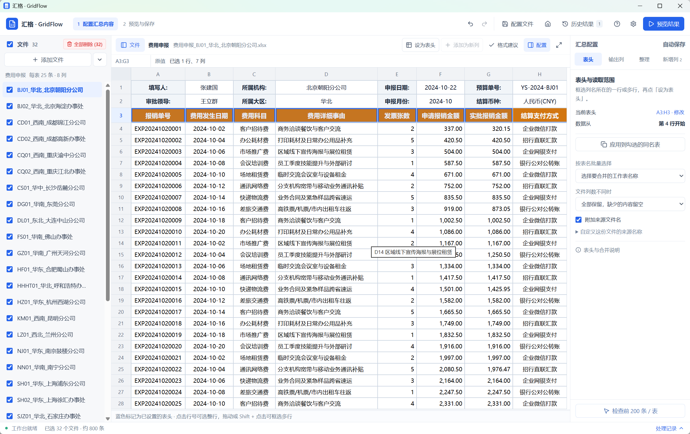

# 汇格 · GridFlow 交互设计

面向 Windows 日常办公，使用单一蓝色强调色、浅色背景和紧凑工具栏。配置时专注原表，生成后专注结果；高级说明按需展开，输入与选区自动保留。

## 任务入口与步骤

首页区分“汇总表格”和“批量改文件名”，分别说明用途、三步流程和开始操作。顶部仅保留工具切换与辅助操作；工作区上方用独立步骤栏标明当前位置、下一步及当前主操作。返回主页保留工作，清空只通过明确的“清空并重置”入口操作。

汇总默认展示表头和输出列，“整理数据、补充信息”放在“更多处理”中；完整汇总表和每张来源表前 200 行的样本预览明确区分。重命名先组成文件名，再按需调整分隔符、前后缀和内容校验；核对按钮不可用时说明需要补齐什么。小窗口下规则区整体滚动，主操作保留在步骤栏。

## 原表上的配置

导入后打开第一份文件，按 Excel 原有单元格格式预览。点击单元格添加固定信息新列，拖动或 Shift 扩选表头，支持一行、多行与合并单元格父标题。应用前核对实际列名，确认是否同时用于勾选的同名表。

## 紧凑的文件列表

单工作表文件一行显示，重复表名和一致的行列信息只显示一次，共同文件名前缀收起。完整名称、大小等信息悬停可查。多工作表按需展开，支持整文件与单表选择；删除在悬停或聚焦时显示，仍需确认。

每项高度由约 103px 降到 36px，文件名字号保持 13px。32 份费用申报文件在 1440×900 逻辑窗口中可同时完整显示 18 项，长列表只在侧栏内滚动。

## 结果与反馈

结果页隐藏配置和文件侧栏，统一筛选、统计与保存入口；保存筛选结果时明确标记范围。返回配置保留选区，修改后提示刷新旧结果。成功提示自动收起，错误保持可见；重任务串行运行，可取消和重试。

表头与列类型建议只展示有实际变化的项目，默认不勾选。样本预览标明每表 200 行上限，正式统计覆盖完整数据。编号、原始精度和显示格式分开处理，转换失败保留原值并可定位。

设计参考了用户提供的交互报告和只读检查的 quote-workbench。采用 taste-skill 中适合办公场景的层级、克制装饰和减少重复入口原则，并按企业数据表格的要求保留清晰的操作、对比和焦点反馈；未增加装饰依赖或远程字体。
